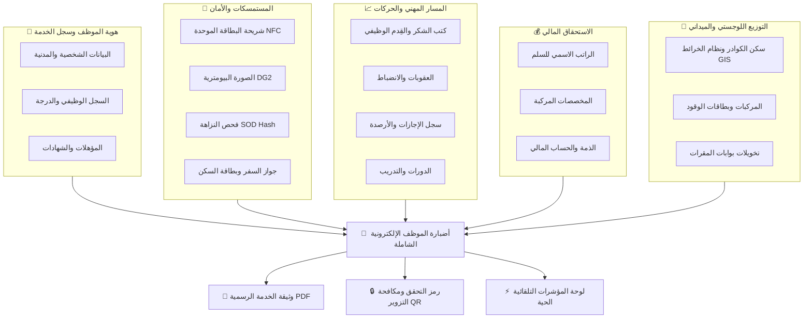
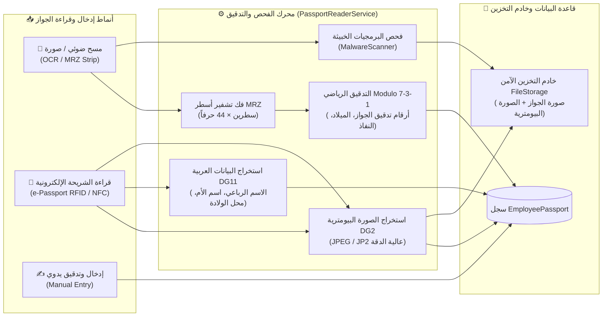

# الدليل الشامل والمعياري لبيانات وأضبارة الموظف (Employee 360° Data Blueprint)
## منظومة إدارة الموارد البشرية المؤسسية — API.HR.Node

* **رمز الوثيقة:** `DOC-HR-EMP-INFO-001`
* **الإصدار:** `2.0.0 (المحدّث الشامل)`
* **حالة الوثيقة:** `معتمدة ونهائية (Official Reference Specification)`
* **الهدف:** توفير مرجع دقيق وشامل ومفصل لكل معلومة، بيان، حقل، وثيقة، ومؤشر حسابي توفره المنظومة عن أي موظف، مع بيان مصدرها، أثرها القانوني، وصلاحيات الاطلاع عليها.

---

## 📌 مخطط الرؤية الشاملة للموظف (Employee 360° Architecture)

يوضح المخطط التالي كيفية تجميع بيانات الموظف من مختلف المصادر في أضبارة رقمية موحدة:



---

## 📑 فهرس الأبواب والمعلومات

| الباب | موضوع البيانات | المحتوى الرئيسي |
|:---:|:---|:---|
| **[1](#1-البيانات-الشخصية-والمدنية-civil--personal-data)** | **البيانات الشخصية والمدنية** | الاسم الرباعي، اسم الأم، الميلاد، الجنس، فصيلة الدم، الحالة الاجتماعية، الأطفال المعالين. |
| **[2](#2-البيانات-الوظيفية-والخدمة-المدنية-employment--service-records)** | **البيانات الوظيفية وسجل الخدمة** | الأرقام الوظيفية، التشكيل، العنوان، المنصب، المباشرة، التثبيت، حالة الموظف بالخدمة، والأرشفة. |
| **[3](#3-البطاقة-الوطنية-الموحدة-والمستمسكات-البيومترية-identity--biometrics)** | **البطاقة الموحدة والمستمسكات** | قراءة الشريحة الإلكترونية، أسطر MRZ، الصورة البيومترية، فحص الأمان SOD Hash، وجواز السفر. |
| **[4](#4-الاستحقاق-المالي-وسلم-الرواتب-والمخصصات-salary--allowances)** | **الرواتب والمخصصات المالية** | الراتب الاسمي للدرجة والمرحلة، مخصصات الشهادة، المنصب، الخطورة، الزوجية، الأطفال، وبدل النقل. |
| **[5](#5-السكن-والعنوان-الجغرافي-الدقيق-residence--gis-location)** | **السكن ونظام الخرائط GIS** | بطاقة السكن، المحلة، الزقاق، الدار/الشقة، أقرب نقطة دالة، والإحداثيات الجغرافية (GPS). |
| **[6](#6-المؤهلات-الأكاديمية-والشهادات-education--degrees)** | **الشهادات الأكاديمية** | التحصيل العلمي، التخصص العام والدقيق، جهة التخرج، سنة ومعدل التخرج، وتاريخ معادلة الشهادة. |
| **[7](#7-سجل-الدورات-التدريبية-والتأهيل-training--certifications)** | **الدورات التدريبية** | البرامج التدريبية، الساعات المعتمدة، جهة التدريب، التقييم، وتصنيف الدورة الحتمية للترفيع. |
| **[8](#8-كتب-الشكر-والتقدير-والقِدم-الوظيفي-appreciation-letters--seniority)** | **كتب الشكر والقِدم الوظيفي** | كتب الشكر، الجهات المانحة، احتساب القِدم التلقائي، السقف السنوي، وإطفاء العقوبات الانضباطية. |
| **[9](#9-العقوبات-الانضباطية-وآثار-التأخير-disciplinary-sanctions)** | **العقوبات والانضباط الوظيفي** | لفت النظر، الإنذار، التوبيخ، قطع الراتب، مدد تأخير الترفيع والعلاوة، وحالة الإطفاء والرد. |
| **[10](#10-الإجازات-والغيابات-والأرصدة-leaves--balances)** | **الإجازات والدوام الرسمي** | رصيد الإجازات المتبقي، السجل التاريخي للإجازات المتمتع بها (اعتيادية، مرضية، دراسية، أمومة...). |
| **[11](#11-سجل-ذوي-الشهداء-والضحايا-martyr-kinship-records)** | **ذوي الشهداء والضحايا** | اسم الشهيد، صلة القرابة، فئة الشهادة، رقم قرار مؤسسة الشهداء، وتمديد سن التقاعد إلى 65 سنة. |
| **[12](#12-أسطول-المركبات-والامتثال-اللوجستي-vehicles--fleet-compliance)** | **المركبات وتخويلات الدخول** | نوع وموديل المركبة، رقم اللوحة، حصة الوقود الشهرية باللتر، الفحص الفني، وتخويلات البوابات. |
| **[13](#13-وسائل-الاتصال-والحسابات-المعتمدة-contact-details)** | **وسائل الاتصال والتواصل** | أرقام الهواتف (شخصي، عمل، طوارئ)، البريد المؤسسي والشخصي، وحساب النظام المرتبط. |
| **[14](#14-مشاركات-الموظف-ومقترحاته-والشكاوى-feedback--grievances)** | **المقترحات والشكاوى** | الأفكار والملاحظات الميدانية، الشكاوى السرية، المرفقات، وحالة الرد والتوجيهات الإدارية. |
| **[15](#15-المؤشرات-الحسابية-والذكية-computed-metrics--kpis)** | **المؤشرات التلقائية الذكية** | الخدمة الفعلية التراكمية، العمر الدقيق، العد التنازلي للتقاعد، تاريخ استحقاق الترفيع والعلاوة القادمة. |
| **[16](#16-خلاصة-الخدمة-الرسمية-والتحقق-بـ-qr-official-dossier--qr)** | **الوثيقة الرسمية والتحقق QR** | ملف PDF الرسمي الموحد، تفاصيل الختم الرقمي، وصفحة التحقق السريع لمكافحة التزوير. |
| **[17](#17-مصفوفة-سرية-البيانات-وصلاحيات-الاطلاع-data-sensitivity--access)** | **مصفوفة السرية والوصول** | تصنيف كل بيان (`Internal`, `Restricted`, `Highly Restricted`) ومن يحق له الاطلاع عليه. |

---

# 1. البيانات الشخصية والمدنية (Civil & Personal Data)

> [!NOTE]
> هذه البيانات تمثل الهوية الثبوتية الدائمة للموظف في سجلات الأحوال المدنية ولا تتغير إلا بأحكام قضائية أو قرارات رسمية مصدقة.

| البيان المطلوب | الحقل البرمجي | مصدر المعلومة | نوع القيمة والتحقق | الأثر القانوني والوظيفي | مثال تطبيقي |
|:---|:---|:---|:---|:---|:---|
| **الاسم الكامل** | `Name` | شريحة البطاقة / يدوي | نصي إلزامي (حتى 300 حرف) | الاسم المعتمد في كافة الأوامر والمخاطبات الرسمية | `أحمد حسن علي الموسوي` |
| **الاسم الأول** | `FirstName` | شريحة البطاقة (`DG11`) | نصي (100 حرف) | المعاملات الإلكترونية والنداء الآلي | `أحمد` |
| **اسم الأب** | `SecondName` | شريحة البطاقة (`DG11`) | نصي (100 حرف) | التحقق من صلة النسب والأضبارة | `حسن` |
| **اسم الجد** | `ThirdName` | شريحة البطاقة (`DG11`) | نصي (100 حرف) | التمييز بين الأسماء المتشابهة | `علي` |
| **اسم والد الجد واللقب** | `FourthName` | شريحة البطاقة (`DG11`) | نصي (100 حرف) | اللقب الرسمي والعشائري | `الموسوي` |
| **اسم الأم الثلاثي** | `MotherName` | شريحة البطاقة (`DG11`) | نصي إلزامي (150 حرف) | التحقق الأمني الرسمي وفض تشابه الأسماء | `فاطمة كاظم جاسم` |
| **تاريخ الميلاد** | `BirthDate` | شريحة البطاقة / يدوي | تاريخ دقيق (`DateOnly`) | أساس حساب العمر وموعد التقاعد القانوني | `1985/04/12` |
| **الجنس** | `Gender` | البطاقة الوطنية الموحدة | قائمة (`ذكر` / `أنثى`) | تنظيم الإجازات الخاصة (أمومة، ولادة، عدة) | `ذكر` |
| **فصيلة الدم** | `BloodType` | يدوي / بطاقة صحية | قائمة محددة من 8 فصائل | خطط الاستجابة للطوارئ والإسعاف الميداني | `O+` |
| **الديانة** | `Religion` | سجلات الخدمة المدنية | قائمة منسدلة معتمدة | العطل الدينية الرسمية والإجازات الخاصة (كالحج) | `مسلم` |
| **القومية** | `Nationality` | سجل الموظف | قائمة (عربي، كردي، تركماني..) | التوثيق الإحصائي الاتحادي | `عربي` |
| **الجنسية** | `Citizenship` | وثيقة السفر / البطاقة | رمز الدولة (ISO-3) | شرط التعيين بالخدمة المدنية العامة | `العراقية (IRQ)` |
| **الحالة الاجتماعية** | `MaritalStatus` | البطاقة الوطنية / يدوي | أعزب، متزوج، أرمل، مطلق | استحقاق مخصصات الزوجية والإعالة | `متزوج` |
| **عدد الأطفال المعالين**| `DependentChildrenCount`| قيود الأحوال المدنية | رقم صحيح (أكبر من أو يساوي 0) | احتساب مخصصات الأطفال في الراتب الشهري | `3 أطفال` |

---

# 2. البيانات الوظيفية والخدمة المدنية (Employment & Service Records)

> [!IMPORTANT]
> هذه البيانات تحدد التبعية الإدارية الدقيقة للموظف، خطوط القيادة والإشراف، وحالته القانونية المستمرة في الخدمة المدنية.

| البيان المطلوب | الحقل البرمجي | مصدر المعلومة | الوصف والقيمة | الأثر الإداري والوظيفي | مثال واقعي |
|:---|:---|:---|:---|:---|:---|
| **الرقم الوظيفي الداخلي** | `EmployeeID` | الموارد البشرية | رقم فريد غير مكرر (`Unique`) | المعرف الأساسي في كافة الإجراءات والبحث والرواتب | `10842` |
| **الرقم الوظيفي الموحد** | `UnifiedEmployeeNumber`| وزارة التخطيط / المالية | رقم مركزي على مستوى الدولة | ربط بيانات الموظف بقاعدة البيانات الوطنية المركزية | `9841205411` |
| **التشكيل الإداري** | `Formation` | الهيكل الإداري للمنظومة | الدائرة أو المديرية الكبرى | حصر وتصفية الصلاحيات ومؤشرات لوحة القيادة | `دائرة العمليات المالية` |
| **الوحدة الإدارية المباشرة**| `AdministrativeUnit` | شجرة الهيكل التنظيمي | القسم أو الشعبة المباشرة | تحديد التبعية الإدارية وسلسلة الموافقات اليومية | `قسم المقاصة الإلكترونية` |
| **العنوان الوظيفي** | `JobTitle` | جدول العناوين المعتمد | العنوان وفق قانون الملاك | تحديد السقف الأعلى للدرجة الوظيفية والمسار المهني | `رئيس مهندسين أقدم` |
| **المنصب الإشرافي الفعلي**| `PositionTitle` | أمر التكليف الإداري | المنصب الإشرافي الواقعي | استحقاق مخصصات المنصب وإسناد مهام الاعتماد | `مدير قسم` |
| **تاريخ أول تعيين** | `HireDate` | الأمر الوزاري للتعيين | تاريخ أول تعيين بالدولة | حساب مدة الخدمة الكلية لأغراض التقاعد والترفيع | `2008/11/01` |
| **تاريخ المباشرة الأولى** | `CommencementDate` | أمر المباشرة الميداني | تاريخ المباشرة الفعلية بالعمل | بدء احتساب الراتب والاستحقاقات المالية الفعلية | `2008/11/15` |
| **تاريخ التثبيت على الملاك**| `ConfirmationDate` | أمر إداري بالتثبيت | تاريخ انتهاء فترة التجربة القانونية | التمتع بكامل حقوق الموظف الدائم وتولي المناصب | `2009/11/15` |
| **تاريخ نيل آخر عنوان** | `LastJobTitleDate` | آخر أمر ترقية صادر | تاريخ الترقية لعنوانه الحالي | تدقيق مدة المكوث بالدرجة المطلوبة للترفيع القادم | `2022/07/01` |
| **تاريخ آخر علاوة سنوية**| `LastAllowanceDate` | آخر أمر علاوة سنوية | تاريخ منح العلاوة للمرحلة الحالية | احتساب موعد استحقاق العلاوة السنوية القادمة | `2025/07/01` |
| **حالة الموظف بالخدمة** | `EmployeeStatus` | سجل الملاك اليومي | (مستمر، منسب، معار، مجاز...) | تحديد أحقية التمتع بالراتب والمناصب والإجازات | `مستمر بالخدمة` |
| **حالة الاستبعاد (الأرشفة)**| `IsArchived` | أمر استبعاد من HR | قيمة منطقية (`True` / `False`) | حجب السجل من كافة التقارير النشطة دون حذفه | `False` (غير مستبعد) |
| **بيانات أمر الاستبعاد** | `ArchivedAt`, `ArchiveReason`| إدارة النظام | تاريخ وسبب ومسؤول الاستبعاد | التوثيق الرقابي لعدم ظهور الموظف في القوائم | `2026/01/10 - إعارة خارجية`|

---

# 3. البطاقة الوطنية الموحدة والمستمسكات البيومترية (Identity & Biometrics)

> [!TIP]
> تستخرج المنظومة البيانات المعتمدة مباشرة من شريحة البطاقة الوطنية الموحدة الإلكترونية وشريحة جواز السفر الإلكتروني وفق المعايير الدولية الصادرة عن منظمة الطيران المدني الدولي (**ICAO Doc 9303**)، مما يمنع أي خطأ يدوي في كتابة الأسماء أو الأرقام ويوفر تدقيقاً رياضياً وبيومترياً حياً.

---

### 3.1. البطاقة الوطنية الموحدة وشريحة الهوية الإلكترونية (National ID Card & NFC)

```
┌────────────────────────────────────────────────────────────────────────┐
│             بيانات شريحة البطاقة الموحدة المستخرجة (TD1 / 3 Lines)      │
├────────────────────────────────┬───────────────────────────────────────┤
│ DG1: Machine Readable Zone     │ أسطر شريط القراءة الآلية الثلاثة (3×30)│
│ DG2: Biometric Facial Image    │ صورة الوجه البيومترية الرسمية للبطاقة │
│ DG11: Personal Details         │ الاسم الرباعي واللقب واسم الأم والولادة│
│ Security: Passive Auth & SOD   │ البصمة المشفرة للتحقق من عدم تلاعب الشريحة│
└────────────────────────────────┴───────────────────────────────────────┘
```

| البيان المستخرج | الرمز في الشريحة | الوصف والهدف | مستوى السرية |
|:---|:---:|:---|:---:|
| **رقم الوثيقة (Document No)** | `DocumentNumber` | رقم الهوية المطبوع والمنقوش على واجهة البطاقة | `Restricted` |
| **الرقم الوطني الموحد (12 رقماً)**| `NationalIdNumber` | الرقم الوطني الدائم غير القابل للتكرار للمواطن | `Restricted` |
| **الاسم العربي الرسمي الكامل** | `FullNameAr` (`DG11`) | الاسم المطابق لسجلات مديرية الأحوال المدنية والجوازات | `Internal` |
| **الاسم اللاتيني المعتمد** | `FullNameEn` (`DG1`) | الاسم المطابق للتعاملات والمخاطبات الدولية | `Internal` |
| **تاريخ الإصدار والنفاذ** | `IssueDate`, `ExpiryDate`| تاريخ إصدار ونهاية صلاحية الهوية لمتابعة التجديد | `Internal` |
| **شريط القراءة الآلية (MRZ)** | `MrzLines 1, 2, 3` | الأسطر المشفرة المقروءة عبر الماسحات الضوئية الآلية | `Restricted` |
| **الصورة البيومترية الأصلية** | `ChipPhotoBase64` (`DG2`) | صورة الوجه عالية الدقة المستخرجة رقمياً لمطابقة الملامح | `Highly Restricted`|
| **بصمة الأمان (SOD Hash)** | `SodHash` | التوقيع الرقمي الحكومي المعتمد لإثبات صحة الشريحة وعدم تزويرها | `Highly Restricted`|
| **المسح الضوئي لوجهي البطاقة** | `Front & Back Image` | نسخة ملونة للوجهين الأمامي والخلفي لأرشفة الأضبارة | `Restricted` |

---

### 3.2. جواز السفر العراقي المقروء آلياً والبيومتري (Iraqi e-Passport Specification)

يدعم النظام معالجة جوازات السفر بنمطين تقنيين متقدمين وفق معيار **ICAO Doc 9303 Part 4 (TD3 Size: 2 Lines × 44 Characters)**:



#### أ. معيار شريط القراءة الآلية (MRZ — Machine Readable Zone):
* يتكون شريط الـ MRZ في الجواز العراقي من **سطرين بطول 44 حرفاً** لكل سطر بخط `OCR-B` القياسي:
  * **السطر الأول (Line 1):**
    * الخانات `[0..1]`: نوع الوثيقة (`P` عادي، `PD` دبلوماسي، `PS` خدمة).
    * الخانات `[2..4]`: رمز الدولة المصدرة (`IRQ`).
    * الخانات `[5..43]`: اللقب والأسماء باللغة الإنكليزية مفصولة برمز (`<<`).
  * **السطر الثاني (Line 2):**
    * الخانات `[0..8]`: رقم جواز السفر (9 خانات).
    * الخانة `[9]`: **رقم التدقيق الرياضي للجواز (Passport Check Digit)**.
    * الخانات `[10..12]`: الجنسية (`IRQ`).
    * الخانات `[13..18]`: تاريخ الميلاد بصيغة `YYMMDD`.
    * الخانة `[19]`: **رقم التدقيق الرياضي لتاريخ الميلاد (DOB Check Digit)**.
    * الخانة `[20]`: الجنس (`M` ذكر / `F` أنثى / `<` غير محدد).
    * الخانات `[21..26]`: تاريخ نفاذ الجواز بصيغة `YYMMDD`.
    * الخانة `[27]`: **رقم التدقيق الرياضي لتاريخ النفاذ (Expiry Check Digit)**.
    * الخانات `[28..41]`: الرقم الوطني أو الرقم الشخصي الموحد (14 خانة).
    * الخانة `[42]`: رقم تدقيق الرقم الشخصي.
    * الخانة `[43]`: **رقم التدقيق المركب العام (Composite Check Digit)**.

#### ب. خوارزمية التحقق والتدقيق الرياضي (Modulo 7-3-1 Algorithm):
* يُخضع النظام كل بيان مشفر لعملية مطابقة رياضية صارمة:
  $$\text{Check Digit} = \left(\sum_{i=0}^{n-1} \text{Value}(c_i) \times \text{Weight}(i \pmod 3)\right) \pmod{10}$$
  حيث الأوزان الدورية هي $[7, 3, 1]$، والقيم الحرفية ($0-9 \to 0-9$, $A-Z \to 10-35$, $<$ $\to 0$).
* **الأثر الرقابي:** في حال عدم تطابق رقم التدقيق الرياضي، يعطي النظام تنبيهاً فورياً بوجود خطأ في المسح الضوئي أو تلاعب برقم الجواز.

#### ج. تفريغ مجموعات بيانات الشريحة البيومترية (e-Passport Chip Data Groups):
1. **المجموعة الأولى (DG1):** أسطر القراءة الآلية (MRZ) الكاملة والمطابقة لمعيار ICAO.
2. **المجموعة الثانية (DG2):** استخراج صورة الوجه البيومترية الأصلية للموظف بجودتها العالية دون ضغط وحفظها في التخزين الآمن وتعيينها كصورة بيومترية معتمدة (`BiometricPhotoKey`).
3. **المجموعة الحادية عشرة (DG11):** البيانات الوطنية باللغة العربية:
   * الاسم الرباعي واللقب باللغة العربية.
   * اسم الأم الكامل.
   * محل الولادة ومحافظة السكن.
   * الرقم الوطني الموحد المربوط بمنظومة الأحوال المدنية.

#### د. جدول الحقول البرمجية لجواز السفر (`EmployeePassport`):

| الحقل البرمجي | النوع | المصدر وطريقة الملء | الوصف والأهمية الإدارية | مثال تطبيقي |
|:---|:---:|:---|:---|:---|
| `PassportNumber` | `string` | MRZ / شريحة / يدوي | رقم الجواز الرسمي الإلزامي المعتمد | `A12345678` |
| `PassportType` | `string` | MRZ / شريحة / يدوي | فئة الجواز (`عادي (P)`، `دبلوماسي (D)`، `خدمة (S)`) | `عادي (P)` |
| `CountryCode` | `string` | شريط MRZ | رمز الدولة الدولي المعتمد | `IRQ` |
| `IssuingCountry` | `string` | مشتق من الرمز | الدولة المصدرة للجواز | `العراق` |
| `IssuingAuthority` | `string?` | الشريحة / يدوي | جهة الإصدار الرسمية | `مديرية شؤون الجوازات` |
| `NationalIdNumber` | `string?` | MRZ / DG11 / يدوي | الرقم الوطني الموحد (12 رقماً) | `198512345678` |
| `FullNameAr` | `string?` | شريحة (`DG11`) / يدوي | الاسم الرباعي واللقب بالعربية | `أحمد علي حسين آل مهدي` |
| `FullNameEn` | `string?` | شريط MRZ (`DG1`) | الاسم الكامل بالإنكليزية كما هو بالجواز | `AHMED ALI AL MEHDI` |
| `MotherName` | `string?` | شريحة (`DG11`) / يدوي | اسم الأم الثلاثي للموظف | `فاطمة حسن كاظم` |
| `PlaceOfBirth` | `string?` | شريحة (`DG11`) / يدوي | محل الولادة المثبت بالجواز | `بغداد - الكرخ` |
| `DateOfBirth` | `DateOnly?` | MRZ / الشريحة | تاريخ الميلاد المدقق حسابياً | `1985/07/15` |
| `Gender` | `string?` | MRZ / الشريحة | الجنس (`ذكر` / `أنثى`) | `ذكر` |
| `IssueDate` | `DateOnly?` | الشريحة / يدوي | تاريخ إصدار الجواز | `2024/07/15` |
| `ExpiryDate` | `DateOnly?` | MRZ / الشريحة | تاريخ انتهاء نفاذ الجواز ومتابعة صلاحيته | `2032/07/15` |
| `RawMrz` | `string?` | الماسح الضوئي / الشريحة | النص الكامل لسطري الـ MRZ المشفرين لأغراض التدقيق | `P<IRQAL<<AHMED...` |
| `PassportImageKey` | `string?` | رفع الملف + فحص أمني | مسار صورة صفحة البيانات الممسوحة ضوئياً بعد فحصها ضد الفيروسات | `passports/EMP-001/uuid_page.jpg` |
| `BiometricPhotoKey`| `string?` | شريحة الجواز (`DG2`) | مسار الصورة البيومترية الأصلية المستخرجة من شريحة الجواز | `passports/EMP-001/uuid_dg2.jpg` |
| `IsActive` | `bool` | تلقائي في النظام | حالة تفعيل الجواز الحالي المعتمد للموظف | `true` |

---

# 4. الاستحقاق المالي وسلم الرواتب والمخصصات (Salary & Allowances)

> [!NOTE]
> يطبق النظام معادلة احتساب الراتب المعيارية وفق قانون رواتب موظفي الدولة والقطاع العام رقم 22 لسنة 2008 المعدل.

### تفاصيل مفردات الراتب الشهري:

```
الاستحقاق الإجمالي الشهري = 
    الراتب الاسمي المحدد للسلم 
  + مخصصات الشهادة الأكاديمية (نسبة مئوية من الاسمي)
  + مخصصات المنصب الإشرافي (نسبة أو مبلغ مقطوع)
  + مخصصات الخطورة المهنية (نسبة مئوية من الاسمي)
  + مخصصات الزوجية (مبلغ مقطوع شهري)
  + مخصصات الأطفال (مبلغ مقطوع عن كل طفل حتى 4 أطفال)
  + مخصصات الموقع الجغرافي وبدل النقل (مبلغ مقطوع شهري)
```

| مفردة الراتب / الحساب | آلية الاحتساب المعتمدة في النظام | القيمة المستحقة (مثال واقعي) |
|:---|:---|:---|
| **الدرجة الوظيفية** | من الدرجة العاشرة (10) إلى الأولى (1) | `الدرجة الرابعة (4)` |
| **المرحلة الوظيفية** | من المرحلة (1) إلى المرحلة (11) | `المرحلة الثانية (2)` |
| **الراتب الاسمي القانوني** | مربوط آلياً بجدول سلم الرواتب المعتمد | `529,000 دينار عراقي` |
| **العلاوة السنوية المستحقة** | مبلغ الزيادة السنوية عند الانتقال للمرحلة التالية | `10,000 دينار عراقي` |
| **مخصصات الشهادة** | نسبة من الاسمي: (دكتوراه 100%، ماجستير 75%، بكالوريوس 45%) | `238,050 دينار (بكالوريوس 45%)` |
| **مخصصات المنصب** | بحسب أمر التكليف: (مدير عام 50%، مدير قسم 25%، شعبة 15%) | `132,250 دينار (مدير قسم 25%)` |
| **مخصصات الخطورة** | نسبة مئوية بحسب طبيعة العمل وتوصيف الوظيفة | `105,800 دينار (خطورة 20%)` |
| **مخصصات الزوجية** | مبلغ مقطوع شهري يمنح للموظف عن الزوجة غير الموظفة | `50,000 دينار عراقي` |
| **مخصصات الأطفال** | 10,000 دينار عن كل طفل معال (بحد أقصى 4 أطفال) | `30,000 دينار (عن 3 أطفال)` |
| **بدل النقل والموقع** | مبلغ مقطوع شهري حسب التشكيل وموقع العمل | `60,000 دينار عراقي` |
| **مجموع الراتب الإجمالي** | حاصل جمع الراتب الاسمي + كافة المخصصات | **`1,145,100 دينار عراقي`** |
| **الذمة والحساب المالي** | تتبع رصيد الموظف، السلف المستلمة، الديون، والاستقطاعات | `رصيد الذمة وسجل الحركات المالية` |

---

# 5. السكن والعنوان الجغرافي الدقيق (Residence & GIS Location)

> [!CAUTION]
> إحداثيات السكن الدقيقة للمنازل تصنف كبيانات **عالية الحساسية (Highly Restricted)**؛ يحجب النظام الموقع الدقيق عن المشرفين ومدراء التشكيلات ويكتفي بعرض اسم الحي والمنطقة العامة لحماية أمن الكوادر.

| البيان الجغرافي | الحقل في النظام | الوصف والتفاصيل | الفائدة التشغيلية |
|:---|:---|:---|:---|
| **المحافظة والقضاء** | `Governorate`, `District` | المحافظة والقضاء الإداري | التوزيع العام للكوادر وخطوط النقل |
| **مكتب معلومات السكن** | `InformationOffice` | اسم مكتب المعلومات المصدر للبطاقة | التحقق الإداري من صحة الصدور |
| **اسم رب الأسرة بالبطاقة**| `FamilyHeadName` | الاسم المثبت في بطاقة السكن الرسمية | مطابقة السجلات العائلية الرسمية |
| **نوع السكن** | `HousingType` | دار مستقل / شقة سكنية / سكن حكومي | تحديد استحقاق بدل السكن الوظيفي |
| **العنوان التفصيلي (دار)** | `Mahalla`, `Zuqaq`, `Dar` | رقم المحلة، رقم الزقاق، ورقم الدار | العنوان البريدي والميداني الدقيق |
| **العنوان التفصيلي (شقة)** | `Complex`, `Building`, `Apt` | اسم المجمع، رقم العمارة، رقم الشقة | الوصول للمجمعات السكنية |
| **أقرب نقطة دالة** | `NearestLandmark` | علامة مكانية مميزة (جامع، مدرسة، مستشفى) | تسهيل الوصول السريع للدار |
| **إحداثيات الموقع (GPS)** | `Latitude`, `Longitude` | خط الطول ودائرة العرض لمحل السكن | الإسقاط على خريطة السكن الموحدة (GIS) |
| **رقم بطاقة السكن وتاريخها**| `CardNumber`, `IssueDate` | رقم بطاقة السكن وتاريخ إصدارها الرسمي | أرشفة المستمسكات الثبوتية المعتمدة |

---

# 6. المؤهلات الأكاديمية والشهادات (Education & Degrees)

| البيان الأكاديمي | الحقل البرمجي | الوصف والتفاصيل | الأثر الوظيفي |
|:---|:---|:---|:---|
| **التحصيل الدراسي** | `EducationLevel` | دكتوراه، ماجستير، بكالوريوس، دبلوم، إعدادية... | تحديد الدرجة الوظيفية الابتدائية ونسبة المخصصات |
| **التخصص العام** | `GeneralSpecialization` | هندسة، علوم مالية، قانون، إدارة، طب، علوم... | التصنيف والعائلة المهنية للموظف |
| **التخصص الدقيق** | `Specialization` | هندسة حاسبات، اقتصاد كلي، قانون جنائي... | التكليف بالمهام التخصصية والمناصب النوعية |
| **الجهة المانحة** | `UniversityOrInstitute` | اسم الجامعة، الكلية، المعهد، أو المدرسة | التحقق وصحة الصدور والاعتماد الأكاديمي |
| **بلد التخرج** | `GraduationCountry` | الدولة التي منحت المؤهل الأكاديمي | تدقيق معادلة وتقييم الشهادات الخارجية |
| **سنة التخرج والمعدل** | `Year`, `GradeAverage` | سنة التخرج والمعدل المئوي مع التقدير | المفاضلة في التعيين والمناصب والإيفادات |
| **أمر احتساب الشهادة** | `GraduationOrderNo` | رقم وتاريخ الأمر الإداري لاحتساب الشهادة | نفاذ استحقاق المخصصات وترقية العنوان |

---

# 7. سجل الدورات التدريبية والتطوير (Training & Certifications)

| بيان الدورة التدريبية | الوصف التفصيلي | الأثر الوظيفي والقانوني |
|:---|:---|:---|
| **عنوان وموضوع الدورة** | الاسم الكامل للبرنامج التدريبي أو ورشة العمل التخصصية | تطوير مهارات الموظف التخصصية والإدارية |
| **الجهة المنفذة للدورة** | المركز التدريبي المعتمد (داخلي، مراكز وزارية، جهات دولية) | معيارية ومصداقية البرنامج التدريبي |
| **الفترة والتواريخ** | تاريخ بداية ونهاية الدورة التدريبية | توثيق التفرغ التدريبي وتجنب تضارب الدوام |
| **عدد الساعات المعتمدة** | إجمالي ساعات التدريب الفعلية (مثال: 30 ساعة، 60 ساعة) | تجميع الساعات السنوية الإلزامية للموظف |
| **تصنيف الدورة التدريبية**| دورة حتمية للترفيع / دورة تطويرية / دورة أمنية فنية | **شرط إلزامي قانوني للترفيع إلى الدرجة الأعلى** |
| **النتيجة والتقييم النهائي**| نتيجة الاختبار (امتياز، جيد جداً، جيد، اجتياز) | تقييم كفاءة الموظف في الأضبارة السنوية |
| **الشهادة المرفقة** | نسخة ضوئية مؤرشفة لشهادة المشاركة الصادرة | الإثبات الورقي والمستندي للمشاركة والاجتياز |

---

# 8. كتب الشكر والتقدير والقِدم الوظيفي (Appreciation Letters & Seniority)

> [!IMPORTANT]
> كتب الشكر والتقدير ليست مجرد تكريم معنوي، بل تمنح **قِدماً وظيفياً فعلياً** يقدم تاريخ استحقاق الترفيع والعلاوة القادمة، كما تسهم في إطفاء العقوبات الانضباطية السابقة.

| البيان المطلوب | الوصف التفصيلي | الأثر القانوني بموجب قانون الخدمة المدنية |
|:---|:---|:---|
| **الجهة المانحة للشكر** | رئاسة الوزراء، وزير، وكيل وزير، مدير عام، جهات خارجية | يحدد مدة القِدم المكتسبة تلقائياً في النظام |
| **رقم وتاريخ وموضوع الكتاب**| رقم وتاريخ كتاب الشكر الرسمي ونص أسباب التكريم | الإسناد القانوني للترفيع وأرشفة صورة الوثيقة |
| **مدة القِدم المكتسبة** | المدة الزمنية المحسوبة تلقائياً بموجب القانون: | • شكر رئيس الوزراء = **6 أشهر قِدم وظيفي**<br>• شكر الوزير ومن بدرجته = **شهر واحد قِدم** |
| **إجمالي أشهر القِدم المجمعة**| مجموع مدد القدم التراكمية في الدرجة الحالية | تقريب موعد الترفيع القادم بنفس عدد الأشهر |
| **استهلاك السقف السنوي للقِدم**| مراقبة الحد القانوني الأقصى للقِدم الممنوح للدرجة | **السقف الأقصى سنة واحدة (12 شهراً)** لكل ترفيع |
| **حالة إطفاء العقوبات** | هل استُخدم كتاب الشكر في محو عقوبة سابقة؟ | في حال إطفاء عقوبة، لا يمنح الكتاب قِدماً زمنياً إضافياً |
| **صورة الوثيقة الرسمية** | نسخة ضوئية ملونة مؤرشفة لكتاب الشكر الصادر | المرجع الورقي المعتمد عند تدقيق لجان الترقية |

---

# 9. العقوبات الانضباطية وآثار التأخير (Disciplinary Sanctions)

| نوع العقوبة الانضباطية | السند القانوني (قانون انضباط موظفي الدولة) | الأثر المباشر على الترفيع والعلاوة |
|:---|:---|:---|
| **لفت نظر** | أمر إداري مسبب بمخالفة وظيفية | تأخير الترفيع والعلاوة السنوية لمدة **(3) أشهر** |
| **إنذار** | أمر إداري بإنذار الموظف | تأخير الترفيع والعلاوة السنوية لمدة **(6) أشهر** |
| **قطع راتب** | أمر إداري باستقطاع أيام محددة من الراتب | تأخير الترفيع لمدة **(5) أشهر عن كل يوم قطع راتب** |
| **توبيخ** | عقوبة انضباطية مشددة | تأخير الترفيع والعلاوة لمدة **سنة كاملة (12 شهراً)** |
| **إنقاص راتب / تنزيل درجة**| عقوبات عليا تصدر بلجان تحقيقية وزارية | تأخير الترفيع لمدة سنتين أو التنزيل لدرجة أدنى |
| **حالة العقوبة الحالية** | **نافذة** (تؤخر الترفيع) / **مطفأة** (بكتاب شكر) / **ملغاة** | تحديد استحقاق الموظف للترقية في التوقيت الحالي |

---

# 10. الإجازات والغيابات والأرصدة (Leaves & Balances)

| بيان الإجازة والدوام | الوصف والقيمة | الأثر الإداري والمالي |
|:---|:---|:---|
| **رصيد الإجازات المتبقي** | صافي الأيام المتراكمة المستحقة للموظف حتى اليوم | الحد الأقصى للأيام التي يمكن التمتع بها براتب تام |
| **الأيام المستهلكة سنوياً** | إجمالي الأيام التي تمتع بها الموظف خلال العام الحالي | متابعة انتظام الدوام السنوي للكوادر |
| **السجل التاريخي للإجازات** | جدول كامل بكافة الإجازات السابقة منذ أول تعيين | كشف تفصيلي يوضح نوع وتاريخ كل إجازة سابقة |
| **تصنيفات الإجازات السابقة**| اعتيادية، مرضية بتقرير طبي، أمومة، دراسية، حج، بدون راتب | تحديد ما إذا كانت الإجازة تؤثر على الراتب أو القدم |
| **أمر وتفاصيل الإجازة** | رقم وتاريخ الأمر الصادر بمنح الإجازة واسم البديل | توثيق قانونية الغياب وتغطية مهام العمل |

---

# 11. سجل ذوي الشهداء والضحايا (Martyr Kinship Records)

| البيان التوثيقي | الوصف والتفاصيل | الامتياز القانوني والوظيفي |
|:---|:---|:---|
| **اسم الشهيد الكامل** | الاسم الرباعي واللقب للشهيد | التوثيق المعتمد في مؤسسة الشهداء الرسمية |
| **صلة القرابة بالشهيد** | أب، أم، ابن، ابنة، أخ، أخت، زوج، زوجة | تحديد درجة القرابة والشمول بالحقوق القانونية |
| **فئة وتصنيف الشهادة** | ضحايا النظام البائد / ضحايا الإرهاب / الحشد الشعبي | تحديد القانون النافذ المطبق على الحالة |
| **رقم قرار مؤسسة الشهداء**| رقم وتاريخ قرار اللجنة القضائية الخاصة المعتمد | الإثبات القانوني القاطع للاستحقاقات |
| **تمديد سن التقاعد القانوني**| مؤشر تقاعد استثنائي تلقائي في النظام | **تمديد السن القانوني للتقاعد إلى 65 سنة** بدلاً من 60 |

---

# 12. أسطول المركبات والامتثال اللوجستي (Vehicles & Fleet Compliance)

| بيان المركبة والتخويل | الوصف والتفاصيل | الأهمية اللوجستية والأمنية |
|:---|:---|:---|
| **النوع والموديل واللون** | الشركة المصنعة، الموديل، اللون، وسنة الصنع | تحديد مواصفات المركبة (مثال: تويوتا كامري - أبيض) |
| **رقم وحرف وصنف اللوحة** | رقم التسجيل والمحافظة وصنف اللوحة (حكومي / فحص) | التعرف على المركبة عند البوابات الأمنية |
| **رقم الشاسيه ورقم المحرك**| رقم الهيكل التعريفي الفريد للسيارة (VIN) | الأرشفة المادية لمنع استبدال المركبات |
| **صفة التخصيص والاستخدام**| سيارة مخصصة شخصياً / خدمة مشتركة / موكب حماية | تحديد المسؤولية القانونية والمادية عن المركبة |
| **تخويلات الدخول للمقرات** | المقرات المصرح بدخولها (المبنى الرئيسي، الجادرية، أربيل) | الفتح الآلي للبوابات وكاميرات قراءة اللوحات (ANPR) |
| **بطاقة الوقود والحصة الشهرية**| رقم بطاقة الوقود الإلكترونية وكمية الوقود المخصصة | تدقيق استهلاك الوقود الشهري باللترات |
| **صلاحية الفحص الفني (الهزة)**| تاريخ نفاذ الفحص الفني والتأمين الإلزامي | الامتثال للسلامة المرورية وصلاحية السير |

---

# 13. وسائل الاتصال والحسابات المعتمدة (Contact Details)

| بيان الاتصال | التصنيف | الهدف والاستخدام |
|:---|:---|:---|
| **رقم الهاتف الشخصي** | أساسي | الاتصال المباشر بالموظف وإرسال التنبيهات النصية |
| **رقم هاتف العمل / الداخلي**| رسمي | التحويلة المكتبية الداخلية للتواصل بين الأقسام |
| **هاتف الطوارئ** | طوارئ | الاتصال بذوي الموظف في الحالات الصحية أو الطارئة |
| **البريد المؤسسي الرسمي** | رسمي (`@cbi.iq`)| تسجيل الدخول في المنظومة واستلام الإشعارات الرسمية |
| **البريد الإلكتروني الشخصي**| شخصي | استرجاع الحساب وتحديث بيانات التحقق الشخصية |
| **بيانات حساب الدخول** | أمان النظام | اسم المستخدم، الأدوار الممنوحة، والأجهزة المقترنة بالدخول |

---

# 14. مشاركات الموظف ومقترحاته والشكاوى (Feedback & Grievances)

| بيان المشاركة | الوصف والتفاصيل | المسار الإداري والخصوصية |
|:---|:---|:---|
| **تاريخ ووقت التقديم** | التوثيق الزمني بالثانية لإرسال المشاركة | حفظ أسبقية الأفكار والمقترحات التطويرية |
| **تصنيف المشاركة** | فكرة ومبادرة تطويرية / ملاحظة عمل / استفسار / شكوى | توجيه المشاركة للقسم المختص بدراستها |
| **نص وموضوع المشاركة** | الشرح المفصل للفكرة أو الإشكال الميداني المعروض | دراسة المقترح من قبل لجان الموارد البشرية |
| **المستندات المرفقة** | ملفات PDF أو صور داعمة للمقترح أو الشكوى | إثبات الوقائع أو تقديم دراسات الجدوى |
| **حالة المشاركة** | قيد المراجعة / تمت المعالجة / قيد التحقيق / تم الحفظ | متابعة الموظف لما تم بخصوص مشاركته |
| **رد وتوجيهات الإدارة** | النص الرسمي الصادر من الإدارة للموظف | التغذية الراجعة والتواصل الإداري الشفاف |
| **صفة السرية** | هل الشكوى مقدمة بصفة سرية؟ | **حجب اسم الموظف** وتشفير هويته لحمايته من الحرج |

---

# 15. المؤشرات الحسابية والذكية (Computed Metrics & KPIs)

> [!TIP]
> يولد النظام هذه المؤشرات برمجياً في الزمن الحقيقي دون تدخل يدوي، وتتحدث تلقائياً مع مرور كل يوم:

| المؤشر الحسابي الذكي | معادلة الاحتساب التلقائي في النظام | الأهمية الإدارية والوظيفية |
|:---|:---|:---|
| **الخدمة الفعلية التراكمية**| `تاريخ اليوم - تاريخ المباشرة + مدد الخدمة المضافة` | حساب استحقاق التقاعد والترفيع باليوم والشهر والسنة |
| **العمر الدقيق للموظف** | `تاريخ اليوم - تاريخ الميلاد` | تحديد الفئة العمرية بدقة تامة باليوم والشهر والسنة |
| **العد التنازلي للتقاعد** | `تاريخ بلوغ سن 60 (أو 65 لذوي الشهداء) - تاريخ اليوم` | التنبيه الاستباقي قبل التقاعد لإعداد معاملات التصفية |
| **استحقاق العلاوة السنوية** | `تاريخ آخر علاوة + سنة واحدة - مدد التأخير` | تحديد الشهر المستحق لمنح زيادة العلاوة السنوية |
| **استحقاق الترفيع القادم** | `تاريخ الترقية الأخير + سنوات الدرجة - أشهر القدم + التأخير`| تحديد موعد الترفيع للدرجة الأعلى بدقة متناهية |
| **إجمالي أشهر القِدم المكتسب**| `مجموع أشهر كتب الشكر (المحصورة بالسقف السنوي)` | معرفة الرصيد الفعلي المستخدم لتقريب الترفيع |
| **إجمالي مدد تأخير الترفيع** | `مجموع مدد التأخير الناتجة عن العقوبات النافذة` | توثيق التأخير القانوني ومعرفة ما تبقى لإطفائه |
| **صافي رصيد الإجازات المتبقي**| `الرصيد التراكمي المستحق - مجموع الأيام المتمتع بها` | منع تجاوز الإجازات والحفاظ على حقوق الموظف |

---

# 16. خلاصة الخدمة الرسمية والتحقق بـ QR (Official Dossier & QR)

تجمع المنظومة كافة البيانات السابقة في **خلاصة الخدمة الموحدة (Official Service Dossier)** القابلة للتصدير كملف PDF عالي الدقة:

* **مواصفات الملف:** وثيقة رقمية رسمية تتضمن ترويسة البنك المركزي العراقي، شعار الدولة، والأختام الرسمية المعتمدة.
* **محتوى الأضبارة المطبوعة:** تلخيص شامل للبيانات الشخصية، السجل الوظيفي، تفاصيل الراتب، رصيد كتب الشكر، العقوبات، الإجازات، والخدمات السابقة.
* **رمز التحقق الرقمي ومكافحة التزوير (Anti-Fraud QR Code):**
  * كل وثيقة تحمل رمز QR فريد ومشفر مربوط بسجل الموظف الحي في الخادم.
  * بمجرد مسح الرمز بواسطة أي هاتف ذكي، يُفتح رابط التحقق الرسمي للمنظومة (`/verify-dossier`).
  * تظهر للمراجع أو الجهة الخارجية شاشة تدقيق رسمية تطابق بيانات الورقة المطبوعة مع سجل قاعدة البيانات لمنع أي تزوير أو تلاعب ورقي.

---

# 17. مصفوفة سرية البيانات وصلاحيات الاطلاع (Data Sensitivity & Access)

تحدد هذه المصفوفة تصنيف سرية كل معلومة ومن يحق له الاطلاع عليها داخل النظام وفق مبدأ الصلاحيات الأقل (**Principle of Least Privilege**):

| حزمة البيانات والمعلومات | تصنيف السرية | الموظف نفسه | المشرف المباشر | مدير التشكيل | مدير HR المركزي | مدير النظام (Admin) |
|:---|:---:|:---:|:---:|:---:|:---:|:---:|
| **الاسم، العنوان الوظيفي، التشكيل، الصورة** | `Internal` | ✅ نعم | ✅ نعم | ✅ نعم | ✅ نعم | ✅ نعم |
| **أرقام الهواتف والبريد الإلكتروني** | `Confidential` | ✅ نعم | ✅ نعم | ✅ نعم | ✅ نعم | ✅ نعم |
| **تفاصيل الراتب ومفردات الاستحقاق المالي**| `Restricted` | ✅ نعم | ❌ محجوب | ❌ محجوب | ✅ نعم | ✅ نعم |
| **سجل العقوبات والانضباط الوظيفي** | `Restricted` | ✅ نعم | ✅ نعم | ✅ نعم | ✅ نعم | ✅ نعم |
| **المستمسكات وبطاقة السكن وجواز السفر**| `Restricted` | ✅ نعم | ❌ محجوب | ❌ محجوب | ✅ نعم | ✅ نعم |
| **إحداثيات السكن الجغرافية الدقيقة (GPS)**| `Highly Restricted`| ✅ نعم | ❌ المنطقة فقط | ❌ المنطقة فقط | 🔒 بإذن أمني | 🔒 بإذن أمني |
| **البيانات البيومترية وشرائح الهوية والجواز (DG2/SOD)**| `Highly Restricted`| ❌ مشفرة | ❌ محجوب | ❌ محجوب | 🔒 تدقيق فقط | 🔒 مخول رسمي |
| **الشكاوى الإدارية السرية للموظف** | `Strictly Confidential`| ✅ نعم | ❌ محجوب | ❌ محجوب | ❌ محجوب | 🔒 للجنة التحقيق |
